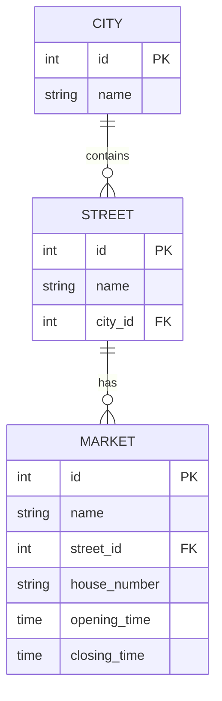

# Simple app as warm-up

Entites:
- Market
- City
- Street

Use-Cases:
- Get cities
- Get streets in a city
- Add a market on a street
- Get markets by street, city, and/or open status (1 or 0)

## Diagrams

Open status (1 or 0) is derived from `opening_time`/`closing_time`, not stored.
A market is open when the current time falls within its window, boundaries
inclusive. Windows that wrap past midnight (e.g. `opening_time=22:00`,
`closing_time=02:00`) are treated as open on either side of the wrap, so the
comparison has two branches: the normal `opening <= now <= closing` case, and
for wrapping windows `now >= opening || now <= closing`. `is_open=0` simply
negates that condition.
