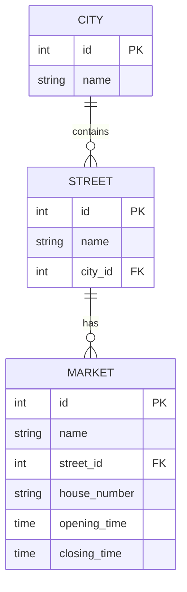

# Simple app as warm-up

Entites:
- Market
- City
- Street

Use-Cases:
- Get cities
- Get streets in a city
- Add a market on a street
- Get markets by street, city, and/or open status (1 or 0)

## Diagrams

Open status (1 or 0) is derived from `opening_time`/`closing_time`, not stored.
